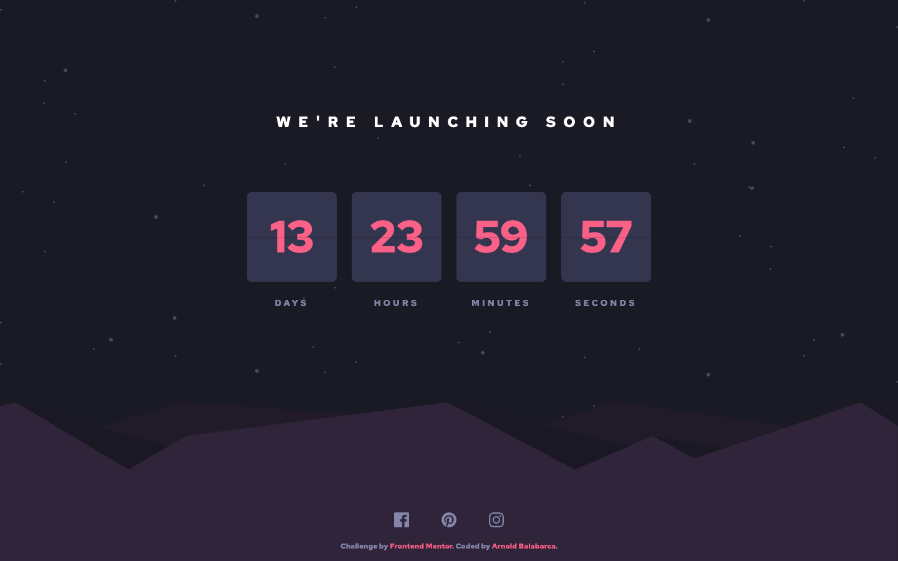

# Frontend Mentor - Launch countdown timer solution

This is a solution to the [Launch countdown timer challenge on Frontend Mentor](https://www.frontendmentor.io/challenges/launch-countdown-timer-N0XkGfyz-). Frontend Mentor challenges help you improve your coding skills by building realistic projects.

## Table of contents

- [Overview](#overview)
  - [The challenge](#the-challenge)
  - [Screenshot](#screenshot)
  - [Links](#links)
- [My process](#my-process)
  - [Built with](#built-with)
  - [What I learned](#what-i-learned)
  - [Continued development](#continued-development)
  - [Useful resources](#useful-resources)
  - [AI Collaboration](#ai-collaboration)
- [Author](#author)
- [Acknowledgments](#acknowledgments)

## Overview

### The challenge

Users should be able to:

- View hover states for all interactive elements on the page
- See a live countdown timer that ticks down every second (starting at 14 days from page load)
- **Bonus**: When a number changes, see the card flip from the middle

### Screenshot



### Links

- Solution URL: [GitHub repository](https://github.com/arn28/launch-countdown)
- Live Site URL: [GitHub Pages](https://arn28.github.io/launch-countdown/)

## My process

### Built with

- [Astro](https://astro.build/) (static output)
- CSS custom properties as design tokens with Tailwind CSS v4 (`@tailwindcss/vite`)
- Flexbox
- Mobile-first workflow
- TypeScript for the countdown logic and client script

### What I learned

- **Design tokens with Tailwind v4**: instead of scattering hex values, the challenge palette (`design-token.json`) was mapped to a `@theme` block in `src/styles/global.css`, so every color and the font family are consumed as utilities (e.g. `bg-card-bg`, `text-text-pink`).
- **Splitting pure logic from the client script**: the countdown math lives in `src/lib/countdown.ts` (`getTimeParts`, `formatValue`), while `src/scripts/countdown.ts` only touches the DOM. Each tick recalculates from `Date.now()` instead of subtracting seconds, which avoids drift.
- **A CSS-only split-flap flip**: each card is built from top/bottom halves plus two animated "flaps". The trick is the handoff — the lower half keeps the old value while the falling flap covers it, then reveals the new value when the animation lands:

```css
.flip-container.flip .flip-flap {
  animation: flipTop 0.6s ease-in forwards;
}

.flip-container.flip .flip-flap-back {
  animation: flipBottom 0.6s ease-out 0.3s forwards;
}
```

- **Accesible timers**: the container uses `role="timer"` with `aria-live="off"` so screen readers don't announce every tick, each unit carries an `aria-label` ("Days: 14") updated by the script, and all flip halves are `aria-hidden="true"`. Lighthouse Accessibility: 100.
- **Respecting `prefers-reduced-motion`**: the flip animation only runs when the user hasn't requested reduced motion — the same media query strips all keyframes.

### Continued development

- Persist the countdown target (e.g. `localStorage`) so a reload doesn't restart the 14 days.
- Explore `@fontsource` to self-host Red Hat Text and remove the Google Fonts runtime dependency.

### Useful resources

- [Astro Docs](https://docs.astro.build) - Guided the project structure and the static `<script>` approach for the client-side timer.
- [Tailwind CSS v4: Theming with CSS variables](https://tailwindcss.com/docs/theme) - Reference for defining the challenge tokens with `@theme`.
- [MDN: prefers-reduced-motion](https://developer.mozilla.org/en-US/docs/Web/CSS/@media/prefers-reduced-motion) - Used for the no-motion fallback of the flip animation.

### AI Collaboration

I used **OpenCode (GLM)** during this project:

- **Implementation plan** — the project was built phase by phase following `docs/PLAN.md`, so every step (tokens, layout, a11y, logic, animation) was verifiable before moving on.
- **Debugging the flip animation** — iterating on the split-flap sequence (top flap falls, bottom flap lands) until the value handoff looked right.
- **QA pass** — running Lighthouse against the production build, which caught an invalid `aria-label` on a plain `div` (fixed by making each unit a labeled `role="group"`).

What worked well: keeping each AI-assisted task scoped to one phase with its own acceptance criteria. What didn't: letting the animation touch too many DOM pieces at once — narrowing the problem to "which half shows which value during the 600ms window" made it solvable.

## Author

- Website - [Arnold Balabarca](https://arn28.github.io/)
- Frontend Mentor - [@arn28](https://www.frontendmentor.io/profile/arn28)

## Acknowledgments

Thanks to Frontend Mentor for the challenge design and style guide.
